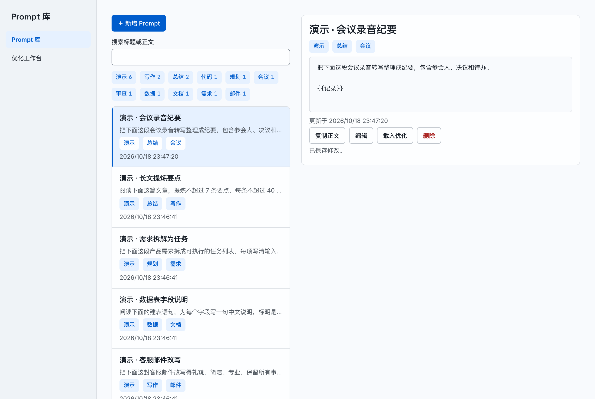
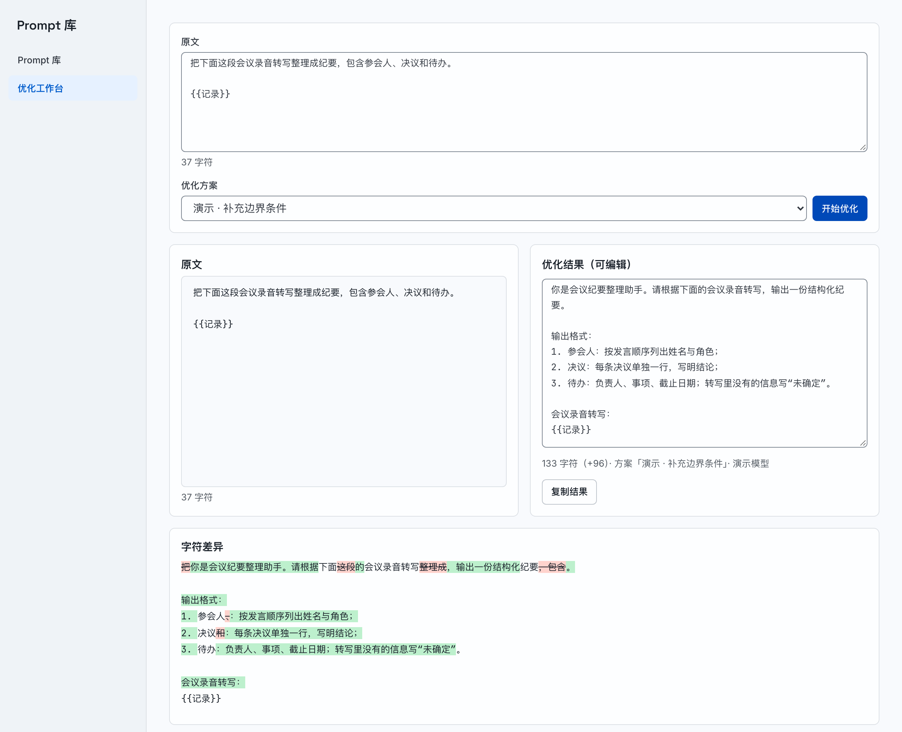

# Prompt 库与优化工作台

收纳提示词，按标签和关键词查找，用优化方案改写，再对照原文编辑并另存。
一个二进制，一个 SQLite 文件，一个站点密码，适合放在自己的机器上长期使用。



*演示实例：Prompt 库。左侧是标签筛选与列表，右侧是选中条目的详情。*

## 功能

- **收纳 Prompt**：每条有标题、正文和多个标签。支持新增、编辑、删除和一键复制正文。
- **查找**：点标签筛选，输入关键词搜索标题和正文，两者可以叠加。
- **优化方案**：方案由名称和正文组成，正文告诉模型怎么改。每次运行保存当时的方案快照，之后改方案不影响历史记录。
- **对照编辑**：工作台把原文与结果并排显示，下方给出字符差异、长度变化和 `{{变量}}` 的丢失与新增。结果可以直接修改，再另存为新 Prompt，原条目保持不变。



*演示实例：优化工作台。左侧为原文，右侧为可编辑的结果，下方是字符差异；原文里的 `{{记录}}` 保留在结果中。*

## 快速开始

环境：Go 1.26、Bun 1.4.3。

```bash
git clone https://github.com/nerdneilsfield/prompts-web.git
cd prompts-web
bun install --frozen-lockfile
bun run build
go build -o bin/server ./cmd/server

APP_PASSWORD='换成你的密码' APP_ORIGIN='http://127.0.0.1:8080' ./bin/server
```

浏览器打开 <http://127.0.0.1:8080>，用 `APP_PASSWORD` 登录。

`bun run build` 生成 `web/dist`，`go build` 把它嵌入二进制，所以两步按这个顺序执行。
`APP_ORIGIN` 填写浏览器地址栏里的地址，写请求按它校验来源。用别的地址访问时，同步修改它，例如 `http://192.168.1.20:8080`。
数据保存在 `DATA_DIR`（默认 `./data`）下的 `prompts.db`。

环境变量在启动时读取，修改后重启进程生效。完整变量表见 [`docs/deploy.md`](docs/deploy.md)。

### 使用镜像

发布的镜像是 `ghcr.io/nerdneilsfield/prompts-web`，支持 `linux/amd64` 与 `linux/arm64`，标签与 Git 标签一致（如 `v1.2.3`），稳定版同时带 `latest`。

```bash
docker pull ghcr.io/nerdneilsfield/prompts-web:latest

docker run -d --name prompts-web -p 8080:8080 \
  -e APP_PASSWORD='换成你的密码' \
  -e APP_ORIGIN=http://127.0.0.1:8080 \
  -v prompts-web-data:/data \
  ghcr.io/nerdneilsfield/prompts-web:latest
```

数据保存在命名卷 `prompts-web-data`。浏览器打开 <http://127.0.0.1:8080> 登录。HTTPS、反向代理和 Apple container 的运行方式见 [`docs/deploy.md`](docs/deploy.md)。

## 使用

1. 点「＋ 新增 Prompt」，填写标题、正文和标签。标签输入后按 Enter 添加，一条 Prompt 可以有多个。
2. 在标签栏点一个标签筛选，再点一次取消；搜索框的关键词与标签同时生效。
3. 打开「优化工作台」，在「方案管理」里新建方案。
4. 在库里点「载入优化」，或直接粘贴原文，选择方案后点「开始优化」。一次优化最长等待约 90 秒。
5. 在右侧修改结果，对照差异和变量提醒，填写标题与标签后点「另存」。
6. 响应在网络中丢失时，点「查询上次请求」取回这次运行的结果，不会重复调用模型。

优化功能需要三个变量：`LLM_BASE_URL`（OpenAI 兼容地址，实际请求 `{LLM_BASE_URL}/chat/completions`）、`LLM_API_KEY` 和 `LLM_MODEL`。
三个都设置后启动：

```bash
LLM_BASE_URL='https://api.example.com/v1' LLM_API_KEY='你的密钥' LLM_MODEL='模型名' \
APP_PASSWORD='换成你的密码' APP_ORIGIN='http://127.0.0.1:8080' ./bin/server
```

缺任意一个时，登录、Prompt 库和方案管理照常使用，新的优化请求返回 503。

想先看到有内容的界面，用 [`docs/evaluation.md`](docs/evaluation.md) 里的命令导入 6 条演示 Prompt 和 3 个演示方案。

## 技术栈

- 后端：Go 1.26 标准库 `net/http` 与 `database/sql`，SQLite 驱动是纯 Go 的 `modernc.org/sqlite`。
- 前端：React 19、TypeScript、Vite，构建产物由 `go:embed` 打进二进制。
- 依赖：Bun（`bun.lock`）与 Go Modules。
- 测试：Go `httptest`，Playwright 端到端。

## 文档

| 文档 | 内容 |
|---|---|
| [`docs/deploy.md`](docs/deploy.md) | 环境变量、Apple container、Compose + HTTPS、可信反向代理、备份恢复与升级 |
| [`docs/development.md`](docs/development.md) | 目录结构、构建检查、前后端分离调试、测试 |
| [`docs/evaluation.md`](docs/evaluation.md) | 导入演示数据，运行 JSONL 评测 |
| [`docs/api.md`](docs/api.md) | HTTP 接口：请求、响应、错误码、字段长度 |
| [`docs/releasing.md`](docs/releasing.md) | 维护者：本地快照构建与打标签发布 |

打 `v*` 标签后，GitHub Actions 用 GoReleaser 构建 Linux、macOS、Windows 的 amd64 与 arm64 归档，附到 Release 页面，同时发布 `checksums.txt` 和上面的多架构镜像。
